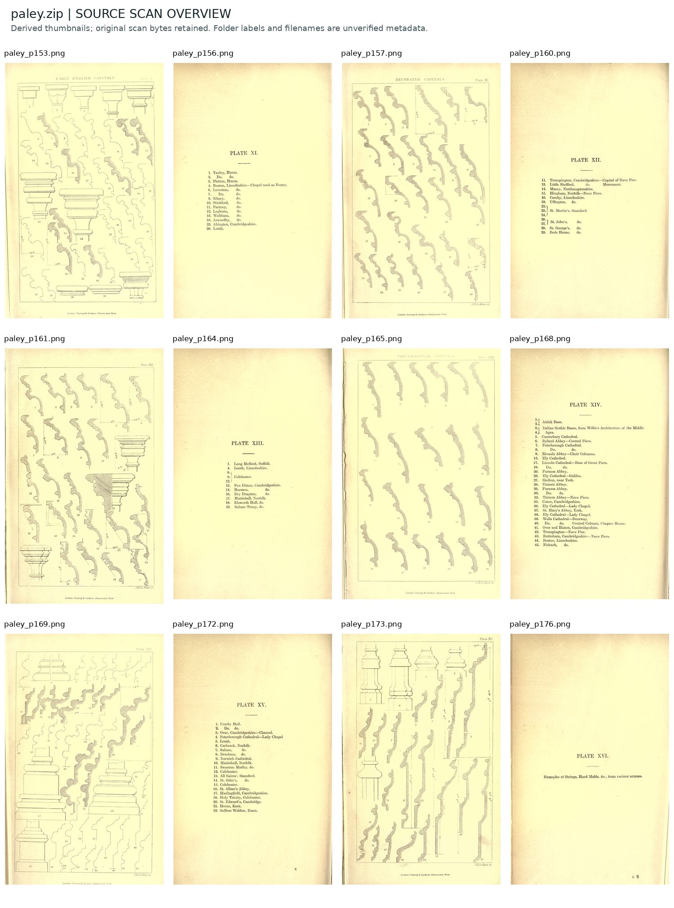
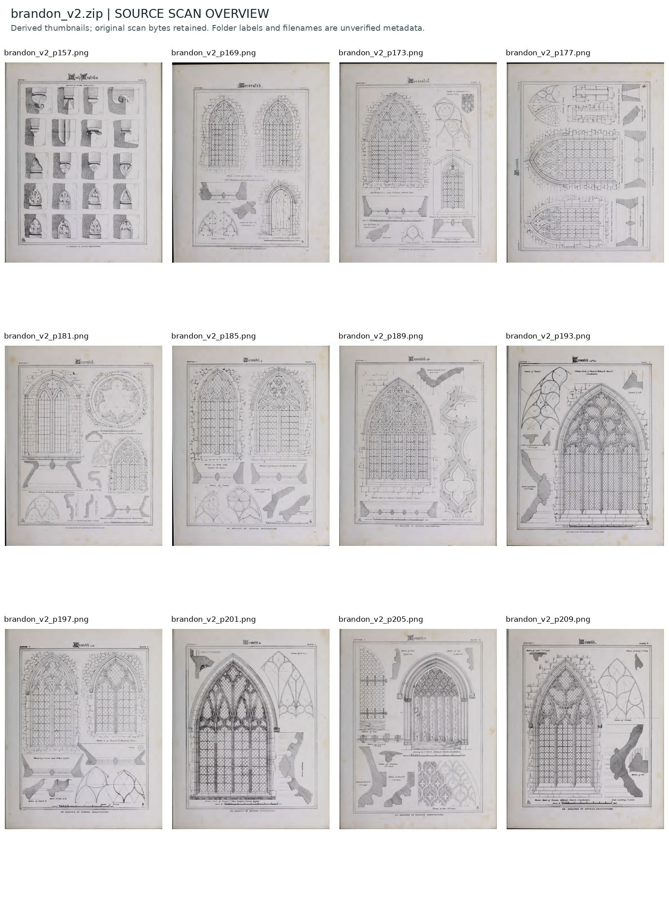
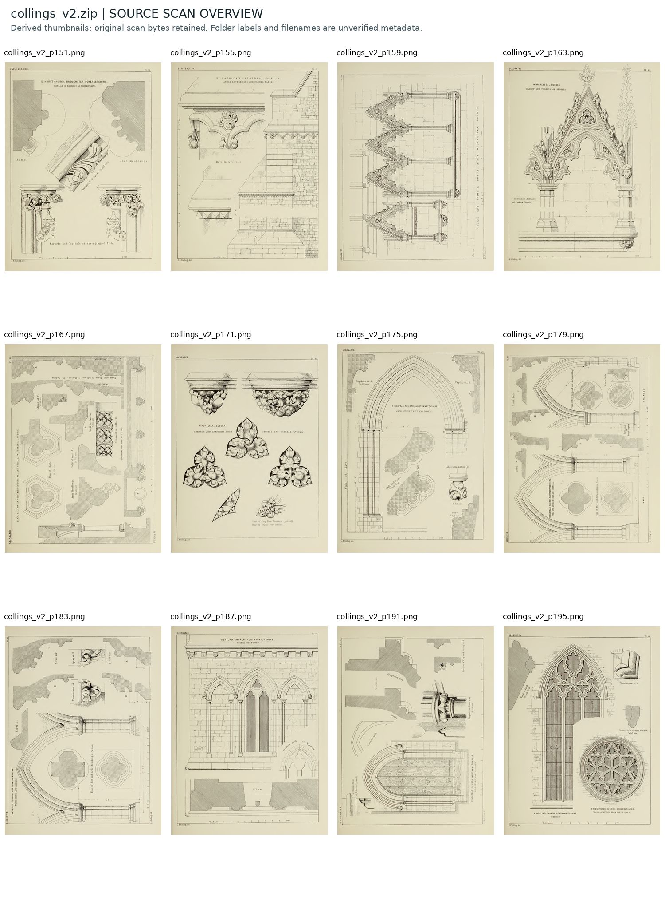
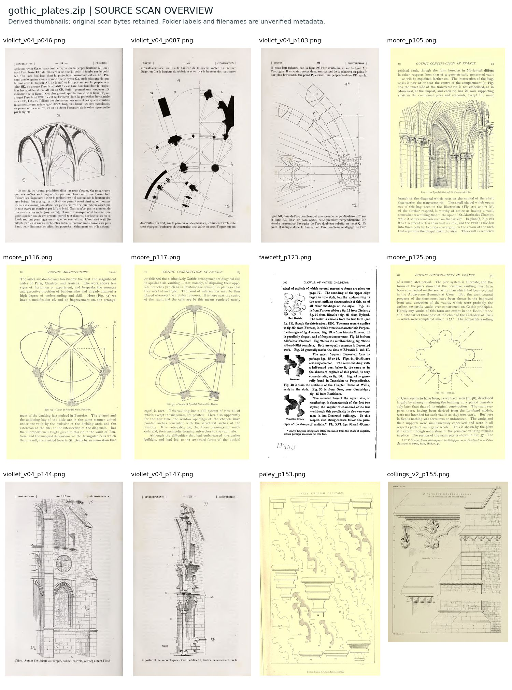

# Uploaded book plates — R02

**All original archives and PNG bytes preserved. Catalog and browsing derivatives only; no architectural promotion.**

| Archive | PNGs | `_blank` folder labels | Other PNGs | Full-resolution original |
|---|---:|---:|---:|---|
| paley.zip | 48 | 24 | 24 | [Original ZIP](https://chatgpt.com/library?file_id=libfile_26b39a8892848191907c95f5a7f94327&account_id=personal) |
| brandon_v2.zip | 133 | 99 | 34 | [Original ZIP](https://chatgpt.com/library?file_id=libfile_1967b8ea51148191b6a36b2108472d16&account_id=personal) |
| collings_v2.zip | 151 | 113 | 38 | [Original ZIP](https://chatgpt.com/library?file_id=libfile_385b1297d408819187974caeac94ef49&account_id=personal) |
| gothic_plates.zip | 111 | 0 | 111 | [Original ZIP](https://chatgpt.com/library?file_id=libfile_d2384b3dfed8819188728b627995ba2f&account_id=personal) |

The four archives contain **443 PNG occurrences, 439 exact-byte-unique images**. Four repeated occurrences are aliases of identical files; both original archive locations remain listed. There are 236 files in folders labelled `_blank`, retained without deletion or automatic visual-blank approval. The remaining 207 files include illustrated plates and supporting text/keys; they are not all independent measured drawings.

Every PNG was read fully, checked against its intake SHA-256, CRC-checked and decoded. Many scans retain continuous paper tone and fine engraving. Tone counts are descriptive; even multi-tone images require a direct original/trace comparison before detailed geometry work. One low-tone candidate is flagged in the detailed summary rather than silently treated as a high-quality tracing source.

## Browse and locate

- [Complete new-file crosswalk](UPLOAD_R02_CROSSWALK.csv): original archive path, asset ID, SHA-256, pixel dimensions, mode, page-number filename hint and original archive link.
- [Detailed source inspection and duplicate groups](UPLOAD_R02_SUMMARY.json).
- [Current combined catalog status](CATALOG_STATUS_R02.json).
- [All batch records](batches/).

Only twelve non-`_blank` entries per archive are pictured below, ordered by filename page hint. These are resampled browsing thumbnails. Always open the linked original archive entry for tracing; printed page, PDF page, book edition and plate number remain separate and unverified until identified from source evidence.

### paley.zip




### brandon_v2.zip




### collings_v2.zip




### gothic_plates.zip



## Tracing leads inspected in this intake

| Candidate | Evidence visible in the inspected source | Status |
|---|---|---|
| `brandon_v2/brandon_v2_p181.png` | Window and foil geometry with accompanying moulding sections and detail drawings | Candidate for our own measured tracing; no geometry generated |
| `brandon_v2/brandon_v2_p169.png` / `p173.png` | Tracery elevations with construction sketches and sections | Candidate; original plate/edition metadata not yet reconciled |
| `plates/paley/paley_p153.png` | Captioned capital and moulding/profile sheet | Profile study candidate, not historic scale approval |
| `plates/moore_profiles/moore_profiles_p405.png` | Profile construction illustration alongside explanatory text | Profile study candidate |

The original Meaux plate has **not** been identified by this intake. None of these candidates is substituted for Meaux, Haina or Châlons, and existing R03 models remain unchanged. Full-book bibliographic identities are not assigned merely from archive labels. Prior master-page IDs and claims are preserved, with no speculative crosswalk to an edition.

## Storage and reproduction

GitHub stores this catalog, checksums, intake tools and small browsing previews. Full-resolution archives remain linked to their existing persistent uploaded files; the originals are not duplicated in ordinary Git history. LFS configuration and approved generators are unchanged.

For the same verified source archives, run the R01 index command once per batch using the corresponding `origins/*UPLOAD_R02.json`, then:

```bash
python3 tools/inspect_plate_uploads_R02.py --archives /path/to/original_zips --library .
```

The tools only read source archives and write distinct catalog/preview artifacts. No automatic monitoring or model regeneration is enabled. `SHA256SUMS_R02.txt` describes this catalog revision; the earlier R01 checksums refer to the preceding R01 Git commit.
